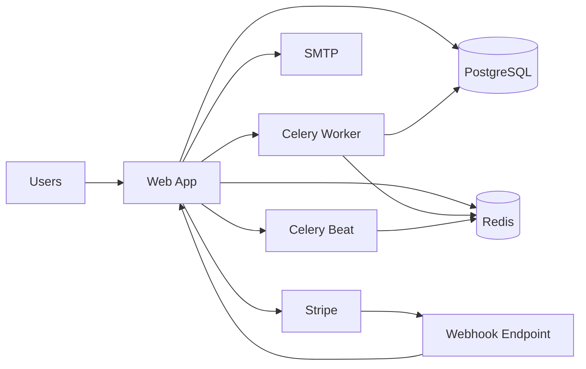

<div align="center">
  

  <h1>DZHub — دزاير هب</h1>
  <p><strong>منصة جزائرية للخدمات والمنتجات الرقمية مع حماية الضمان (Escrow)</strong></p>
  <p><strong>Trusted Algerian marketplace for digital services and products with escrow protection.</strong></p>

  <p>
    
    
    
    
    
    
  </p>

  <p>
    <a href="https://github.com/test-bit-sys/escrow-"></a>
    <a href="CONTRIBUTING.md"></a>
    <a href="LICENSE"></a>
  </p>
</div>

> [!IMPORTANT]
> **🚧 مشروع مفتوح المصدر قيد التطوير النشط (Work In Progress)**  
> هذا المشروع في مرحلة بناء وتطوير مستمر، وهو **مفتوح المصدر بالكامل** ومتاح لكافة المطورين للمساهمة والتطوير. نرحب بكل الأفكار، تحسينات الكود، إصلاحات الأخطاء، وطلبات السحب (Pull Requests). يرجى مراجعة [دليل المساهمة (CONTRIBUTING.md)](CONTRIBUTING.md) و [سياسة الأمان (SECURITY.md)](SECURITY.md).
>
> *This repository is under active development and open for public community contributions. We warmly welcome pull requests, security audits, feature ideas, and feedback!*

<table>
  <tr>
    <td align="center" width="25%">
      <strong>Protected Payments</strong><br />
      Checkout, hold, release, and refund logic
    </td>
    <td align="center" width="25%">
      <strong>Realtime Operations</strong><br />
      Rooms, chat, notifications, and activity flow
    </td>
    <td align="center" width="25%">
      <strong>Trust Layer</strong><br />
      KYC-aware workflows, moderation, and support
    </td>
    <td align="center" width="25%">
      <strong>Deployment Ready</strong><br />
      Health checks, Docker stack, staging, and tests
    </td>
  </tr>
</table>

## Product Vision

DZHub (دزاير هب) is an escrow-first platform designed specifically for digital services and digital products. A transaction remains structured, traceable, and protected from the moment a buyer commits payment until the deal is successfully completed or safely refunded.

Instead of treating escrow as an add-on, the platform places it at the center of the product experience. Listings, rooms, support, notifications, moderation, invoices, and payment state changes are all connected to the transaction lifecycle.

## End-to-End Flow

1. A seller creates a listing or starts a deal.
2. A buyer initiates payment through the platform.
3. The amount is held in escrow rather than released immediately.
4. Both sides continue inside the protected deal room.
5. The transaction concludes through release, refund, or staff review.

## Feature System

### Transaction Core

- Escrow payment lifecycle with hold, release, and refund states
- Fixed-price listings and auction listings
- Invoice visibility and payment audit continuity
- Dedicated success and checkout flows for buyer confidence

### Collaboration Layer

- Real-time escrow rooms
- Private chat and message attachments
- Notification polling and room activity updates
- Structured communication tied directly to the transaction

### Trust and Moderation

- KYC-aware verification states
- Support ticket system and staff review workflows
- Moderation paths for withdrawals, rooms, and user actions
- Protected staff surfaces with access controls

### Operational Readiness

- Docker and production-style compose stack
- Health endpoint for uptime and orchestration checks
- Deployment checklist and env templates
- Full test suite covering core business flows

## Visual Preview

<table>
  <tr>
    <td width="33%">
      
      <p align="center"><strong>Authentication Flow</strong></p>
    </td>
    <td width="33%">
      
      <p align="center"><strong>Trust and Product Layer</strong></p>
    </td>
    <td width="33%">
      
      <p align="center"><strong>Marketplace Experience</strong></p>
    </td>
  </tr>
</table>

## Architecture Snapshot

### Core Stack

- Python 3
- Django 4.2+
- Django Channels
- Celery

### Data and Infrastructure

- PostgreSQL
- Redis
- Docker and Docker Compose

### Integrations

- Stripe
- Google OAuth via `django-allauth`
- SMTP email delivery

## Service Map



## Repository Layout

```text
core/                    Django settings and project configuration
main/                    Main application: views, models, tests, services
templates/               HTML templates
static/                  CSS, JavaScript, and image assets
docker/                  Entrypoint and healthcheck helpers
.env.example             Local development template
.env.production.example  Production environment template
DEPLOYMENT_CHECKLIST.md  Launch and deployment checklist
```

## Quick Start

### Requirements

- Python 3.9+
- PostgreSQL
- Redis
- Virtual environment support

### Local Setup

1. Clone the repository

```bash
git clone https://github.com/test-bit-sys/escrow-.git
cd escrow-
```

2. Create and activate a virtual environment

```bash
# Windows
python -m venv venv
venv\Scripts\activate

# macOS / Linux
python -m venv venv
source venv/bin/activate
```

3. Install dependencies

```bash
pip install -r requirements.txt
```

4. Create the environment file

```bash
cp .env.example .env
```

5. Run database setup

```bash
python manage.py migrate
python manage.py createsuperuser
```

6. Start the app

```bash
python manage.py runserver
```

Local HTTPS for preview:

```powershell
.\run_dev.ps1 -Https
```

Then open `https://localhost:8000/`. The generated certificate is for local development only, so the browser may ask you to accept it the first time.

If port `8000` is still used by an old HTTP server, replace it with:

```powershell
.\run_dev.ps1 -Https -ReplacePort
```

## Docker

Containerized local stack:

```bash
docker compose up --build
```

Production-style stack:

```bash
cp .env.production.example .env.production
docker compose -f docker-compose.prod.yml up --build -d
```

## Configuration

Important environment variables:

- `DJANGO_SECRET_KEY`
- `DJANGO_DEBUG`
- `SITE_URL`
- `DJANGO_ALLOWED_HOSTS`
- `DJANGO_CSRF_TRUSTED_ORIGINS`
- `DATABASE_URL` or `DB_*`
- `REDIS_URL` or `REDIS_HOST` / `REDIS_PORT`
- `STRIPE_PUBLIC_KEY`
- `STRIPE_SECRET_KEY`
- `STRIPE_WEBHOOK_SECRET`
- `EMAIL_HOST_USER`
- `EMAIL_HOST_PASSWORD`

Reference files:

- [DEPLOYMENT_CHECKLIST.md](DEPLOYMENT_CHECKLIST.md)
- [.env.example](.env.example)
- [.env.production.example](.env.production.example)

## Health and Readiness

Built-in health endpoints:

- `/health/`
- `/health/?format=text`

These are suitable for local verification, staging uptime checks, and container health probes.

## Payments and Escrow

The current payment lifecycle is:

1. A checkout is created for a deal.
2. A successful payment moves the deal into escrow.
3. The escrow room becomes active.
4. The platform resolves the deal through release or refund logic.
5. Invoice and audit details remain available in the system.

For local Stripe webhook testing:

```bash
stripe listen --forward-to http://127.0.0.1:8000/stripe/webhook/
```

## Testing

Core verification:

```bash
python manage.py check
python manage.py test --keepdb
```

Deployment-oriented verification:

```bash
python manage.py check --deploy
```

## Deployment Notes

For staging or production, ensure:

- `DJANGO_DEBUG=False`
- PostgreSQL is available
- Redis is available
- Celery worker and beat are running
- Stripe webhook configuration matches `SITE_URL`
- Email delivery is configured
- Secret values are real and not placeholders

## 🤝 Open for Developers / المساهمة والتطوير

هذا المشروع يرحب بكل المطورين والمهتمين بالبرمجيات الحرة! إذا كنت ترغب في المساهمة بكود، تحسين الواجهة، أو الإبلاغ عن أخطاء، فالباب مفتوح لك بالكامل.

### 🌟 مجالات نرحب بالمساهمة فيها (Good First Issues & Roadmap):
- **🌐 تعدد اللغات (i18n):** استكمال تعريب وتدويل النصوص (عربي / إنجليزي / فرنسي).
- **💳 بوابات الدفع (Payment Adapters):** إضافة بوابات دفع محلية (مثل BaridiMob / Satim / CIB) أو تجريبية.
- **📱 تحسينات تجربة المستخدم (UI/UX Polish):** تحسين استجابة الصفحات على الهواتف والأجهزة اللوحية ورفع مستوى إمكانية الوصول (Accessibility).
- **🧪 زيادة التغطية الاختبارية (Tests):** كتابة المزيد من اختبارات الوحدة (Unit Tests) لتدفقات النزاع والمحادثات الحية.
- **⚡ تحسين أداء WebSockets:** تحسين قنوات الاتصال الحي (Django Channels) وحفظ الرسائل في Redis.
- **🔒 تدقيق ومراجعة الأمان:** المساعدة في فحص تدفقات الصرف والحجز وضمان سلامة المنطق المالي.

يرجى مراجعة [دليل المساهمة CONTRIBUTING.md](CONTRIBUTING.md) للبدء في خطوتك الأولى، ولا تتردد في فتح [Issue جديدة](https://github.com/test-bit-sys/escrow-/issues) لمناقشة أي فكرة قبل البدء بها!

## Documentation

- [CONTRIBUTING.md](CONTRIBUTING.md)
- [SECURITY.md](SECURITY.md)
- [DEPLOYMENT_CHECKLIST.md](DEPLOYMENT_CHECKLIST.md)

## License

This project is distributed under the MIT License.

See [LICENSE](LICENSE) for full details.
